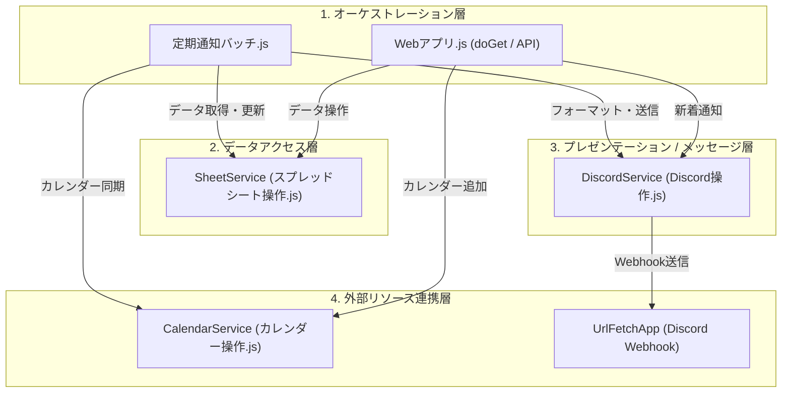

# システムアーキテクチャ & 設計方針書 (`docs/ARCHITECTURE.md`)

本ドキュメントは、`discord-notifier` システムの全体レイヤー構造、責務分担、設計原則、および共通の制約対策について定義・解説します。

---

## 1. 全体レイヤー構造 & 責務分担

本システムは、責務の混在を防ぎ高い保守性を維持するため、以下の 4 層構造で構成されています。



### 1.1 各層の役割とファイル対応

| レイヤー | 主要ファイル / オブジェクト | 責務・役割 |
| :--- | :--- | :--- |
| **オーケストレーション層** | `spreadsheet/定期通知バッチ.js`<br>`spreadsheet/Webアプリ.js` | 処理全体のフロー制御に専念する。<br>・定期バッチ: データの抽出指示 ➔ フォーマット指示 ➔ 送信指示<br>・Webアプリ: リクエスト受付 ➔ 各層の呼び出し ➔ レスポンス返却 |
| **データアクセス層** | `spreadsheet/スプレッドシート操作.js`<br>(`SheetService`) | スプレッドシートのシート構造・列インデックス（`COL_INDEX`）を隠蔽し、データの取得・保存を行う。<br>外部層に対しては名前付きプロパティのモデルオブジェクト（DTO）を返す。 |
| **メッセージ / プレゼンテーション層** | `spreadsheet/Discord操作.js`<br>(`DiscordService` & フォーマッター) | 取得されたモデルオブジェクトから Discord 用のメッセージ（本文・Markdown・ブロック）を組み立て、送信を実行する。 |
| **外部リソース連携層** | `spreadsheet/カレンダー操作.js`<br>(`CalendarService`) | Google カレンダー等の外部サービスへの接続・イベント作成・予定取得を担当する。 |
| **共通設定・定数** | `spreadsheet/設定値.js`<br>`spreadsheet/共通関数.js` | 環境変数・Webhook URL・日付ユーティリティ・エラーロガーなどの横断的機能を集中管理する。 |

---

## 2. 設計原則

### 2.1 関心の分離 (Separation of Concerns)
- バッチ処理関数（`remindEndDate`, `remindPaymentEndDate` 等）の中に、スプレッドシートの列インデックス参照、文字列結合によるメッセージ整形、Discord 送信ロジックを直書きしない。
- 各関数は「データ取得」「メッセージ整形」「送信」の独立したステップで構成し、個別に単体テストや仕様変更が可能な状態を保つ。

### 2.2 カプセル化 & 列インデックスの隠蔽
- スプレッドシートの列定義（`MASTER_COL`, `APPLY_COL`）は `スプレッドシート操作.js` 内に閉じた定数とし、外部ファイル（`設定値.js` やバッチファイル）へ露出させない。
- 呼び出し側（オーケストレーション層等）は、配列のインデックス（`row[0]` や `row[MASTER_COL.BRAND]`）を直接扱わず、必ず `SheetService` から返却される名前付きプロパティを持つオブジェクト配列（DTO）を扱う。
  ```javascript
  // ⭕ 良い例: DTOのプロパティを参照
  items.forEach(item => {
    Logger.log(`${item.brandEvent}: ${item.timeStr}`);
  });

  // ❌ 悪い例: 配列インデックスへの直接アクセス
  items.forEach(row => {
    Logger.log(row[2] + ": " + row[6]);
  });
  ```

### 2.3 DTO (Data Transfer Object) / Parameter Object パターン
- 3つ以上の引数やオプション項目を持つ関数・メソッドは、単一のオブジェクト引数形式とし、JSDoc で構造を明示する。
- 引数の順番間違いによるバグを防止し、引数の追加・省略に柔軟に対応する。
  ```javascript
  /**
   * 終日イベントを Google カレンダーに登録する
   * @param {Object} params
   * @param {string} params.title - イベントタイトル
   * @param {Date|string} params.startDate - 開始日
   * @param {Date|string} [params.endDate] - 終了日
   * @param {string} [params.location] - 会場
   * @param {string} [params.summary] - 概要
   * @returns {string|null}
   */
  CalendarService.createAllDayEvent({
    title,
    startDate,
    endDate,
    location,
    summary
  });
  ```

---

## 3. 共通エラー処理 & 制限対策

### 3.1 Discord API レートリミット (HTTP 429) 自動リトライ
Discord Webhook へのリクエストが短時間に集中した場合、Discord から HTTP 429 (Too Many Requests) が返却されます。  
`DiscordService.sendNotification` では以下のリトライ戦略を標準装備しています：
1. レスポンスヘッダーの `Retry-After` または JSON ボディの `retry_after` 値を解析。
2. 指示された待機時間（ミリ秒）+ 500ms スリープして最大 3 回まで自動再試行。
3. すべて失敗した場合はエラーログを記録し、例外をスロー。

### 3.2 Discord 送信文字数制限 (2000文字) 対策
Discord Webhook の 1 メッセージあたりの上限文字数は 2,000 文字です。  
`DiscordService.sendItemListNotification` では、通知対象のアイテムを安全に分割送信します：
- 累積文字数がフッターを含めて 2,000 文字を超える直前で一度メッセージを送信（`Utilities.sleep(500)` でレートリミットを回避）。
- 新しいメッセージとして次のアイテム群を連結し、最終メッセージの末尾に共通フッターを付与。

### 3.3 プロキシ URL 変換
GAS (Google Apps Script) の IP アドレス帯域が Discord 側でブロックされる問題への対策として、`PROXY_BASE_URL` が設定されている場合は送信先 URL を自動で Cloudflare 等のリバースプロキシ宛に置換します。
```javascript
if (PROXY_BASE_URL && webhookUrl.includes("https://discord.com")) {
  webhookUrl = webhookUrl.replace("https://discord.com", PROXY_BASE_URL);
}
```

### 3.4 統一ロギング
例外発生時は `共通関数.js` の `logError(contextName, error)` を介して、コンテキスト名・エラーメッセージ・スタックトレースを GAS ログに出力します。
