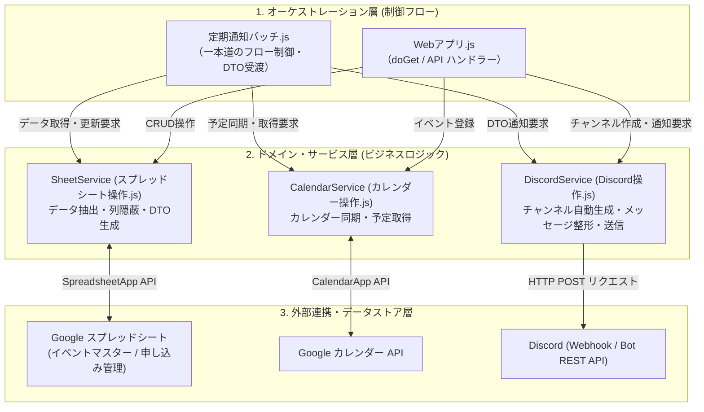

# システムアーキテクチャ & 設計方針書 (`docs/ARCHITECTURE.md`)

本ドキュメントは、`discord-notifier` システムの全体レイヤー構造、責務分担、設計原則、および共通の制約対策について定義・解説します。

---

## 1. 全体レイヤー構造 & 責務分担

本システムは、責務の混在を防ぎ高い保守性を維持するため、以下の 4 層構造で構成されています。



### 1.1 各層の役割とファイル対応

| レイヤー | 主要ファイル / オブジェクト | 責務・役割 |
| :--- | :--- | :--- |
| **オーケストレーション層** | `spreadsheet/定期通知バッチ.js`<br>`spreadsheet/Webアプリ.js` | 処理全体のフロー制御に専念する。<br>・定期バッチ: データの抽出指示 ➔ フォーマット指示 ➔ 送信指示<br>・Webアプリ: リクエスト受付 ➔ 各層の呼び出し（カレンダー・チャンネル作成等） ➔ レスポンス返却 |
| **データアクセス層** | `spreadsheet/スプレッドシート操作.js`<br>(`SheetService`) | スプレッドシートのシート構造・列インデックス（`MASTER_COL`, `APPLY_COL`）を隠蔽し、データの取得・保存を行う。<br>外部層に対しては名前付きプロパティのモデルオブジェクト（DTO）を返す。 |
| **メッセージ / プレゼンテーション層** | `spreadsheet/Discord操作.js`<br>(`DiscordService` & フォーマッター) | ・Discord Webhook へのメッセージ（本文・Markdown・ブロック）整形・送信。<br>・設定駆動（`REMIND_CONFIGS`）によるリマインド通知（締切・先着・リセール・入金）の一元送信（`sendRemindNotification`）および共通フォーマット（`formatRemindItem`）。<br>・Discord Bot REST API によるイベントテキストチャンネル動的生成（サニタイズ・トピック設定・初回Embed投稿）。<br>・Bot REST API 汎用クライアント（`fetchDiscordApi`）による安全なHTTP通信・プロキシ対応・認証ヘッダーカプセル化。 |
| **外部リソース連携層** | `spreadsheet/カレンダー操作.js`<br>(`CalendarService`) | Google カレンダー等の外部サービスへの接続・イベント作成・予定取得を担当する。 |
| **共通関数層 (Utilities / Formatters)** | `spreadsheet/共通関数.js` | 特定の外部APIに依存しない、純粋なデータ変換・フォーマット処理（`formatDateRange`, `formatBrandEventTitle`, 日付計算、ステータス判定等）を担当。<br>オーケストレーション層および各サービス層から共通して参照される。 |
| **型定義層 (Type Definitions)** | `spreadsheet/型定義.js` | JSDoc の `@typedef` を用いて、システム全体で受け渡される DTO（`EventDto`, `ApplicationDto`, `TomorrowEventsDto`, `RemindType`, `RemindConfigDto` 等）のスキーマを一元管理する。 |
| **共通設定・定数** | `spreadsheet/設定値.js` | 環境変数・Webhook URL・Bot トークンなどの設定値やプロパティ取得を集中管理する。 |

---

## 2. 設計原則

### 2.1 関心の分離 (Separation of Concerns)
- バッチ処理関数（`remindEndDate`, `remindPaymentEndDate` 等）の中に、スプレッドシートの列インデックス参照、文字列結合によるメッセージ整形、Discord 送信ロジックを直書きしない。
- 各関数は「データ取得」「メッセージ整形」「送信」の独立したステップで構成し、個別に単体テストや仕様変更が可能な状態を保つ。

### 2.2 カプセル化 & 列インデックスの隠蔽
- スプレッドシートの列定義（`MASTER_COL`, `APPLY_COL`）は `スプレッドシート操作.js` 内に閉じた定数とし、外部ファイル（`設定値.js` やバッチファイル）へ露出させない。
- 呼び出し側（オーケストレーション層等）は、配列のインデックス（`row[0]` や `row[MASTER_COL.BRAND]`）を直接扱わず、必ず `SheetService` から返却される名前付きプロパティを持つオブジェクト配列（DTO）を扱う。
  ```javascript
  // ⭕ 良い例: DTOのプロパティを参照
  items.forEach(item => {
    Logger.log(`${item.brandEvent}: ${item.timeStr}`);
  });

  // ❌ 悪い例: 配列インデックスへの直接アクセス
  items.forEach(row => {
    Logger.log(row[2] + ": " + row[6]);
  });
  ```

### 2.3 DTO (Data Transfer Object) / Parameter Object パターン
- 3つ以上の引数やオプション項目を持つ関数・メソッドは、単一のオブジェクト引数形式とし、JSDoc で構造を明示する。
- **共通型定義ファイル (`spreadsheet/型定義.js`) の活用**:
  - DTO の詳細プロパティ（キー名・型・説明）は `型定義.js` 内の `@typedef` で集中定義する。
  - 各サービスの関数側では `@param {EventDto} event` や `@param {ApplicationDto} application` のように簡潔に型参照を行い、重複した長大 JSDoc によるコード可読性の低下を防ぐ。
  ```javascript
  /**
   * 終日イベントを Google カレンダーに登録する
   * @param {EventDto} event - イベントDTO
   * @returns {string|null}
   */
  CalendarService.createAllDayEvent(event);
  ```

### 2.4 オーケストレーション層の一本道フロー規約
- **早期リターン (ガード節) の禁止**:
  - `定期通知バッチ.js` などのオーケストレーション層では、取得件数による `if (items.length === 0) return;` などの条件分岐を記述しない。
  - 0件時のログ出力や送信スキップ処理は、呼び出されるサービス層（`DiscordService` や `CalendarService`）の内部で完結させる。
  - メイン関数は必ず末尾の完了ログ（`Logger.log("=== ...が正常終了しました ===")`) まで到達する「一本道フロー」を保つ。
- **日付生成・フォーマットのカプセル化**:
  - 実行時の「現在日付」に依存する処理において、メイン関数側で `new Date()` やフォーマット変換を行ってサービス層へ渡さない。
  - 日付計算やデフォルト値生成は `SheetService` や `CalendarService` 内部で自動算出する。
- **DTO バケツリレーの徹底**:
  - サービス層から取得したオブジェクト・配列は、オーケストレーション層で分解・加工せず、そのまま次のサービス層へ受け渡す。

### 2.5 サービス層および共通関数の設計規約
- **共通関数の配置基準**:
  - 特定の外部API（Discord, Calendar, Spreadsheet）に依存しない、純粋なデータ変換・フォーマット処理（日付のフォーマット `formatDateRange`、タイトルの文字列結合 `formatBrandEventTitle` など）は必ず `共通関数.js` に配置する。
  - `DiscordService` や `CalendarService` などの外部サービス用モジュール内に、汎用的な文字列整形関数を持たせてはならない。
- **イベントDTO受け渡しの原則**:
  - オーケストレーション層（`Webアプリ.js`, `定期通知バッチ.js`）でタイトル文字列や日付範囲文字列（`dateStr`）などの表示用データを事前生成してはならない。
  - サービス層（`CalendarService`, `DiscordService`）は、基本情報を持つイベントオブジェクト（DTO: `{ eventId, brand, eventName, startDate, endDate, venue, description }`）を引数として直接受け取り、必要な加工は各サービス内部で共通関数を用いて行う。

---

## 3. 共通エラー処理 & 制限対策

### 3.1 Discord API レートリミット (HTTP 429) 自動リトライ
Discord Webhook へのリクエストが短時間に集中した場合、Discord から HTTP 429 (Too Many Requests) が返却されます。  
`DiscordService.sendNotification` では以下のリトライ戦略を標準装備しています：
1. レスポンスヘッダーの `Retry-After` または JSON ボディの `retry_after` 値を解析。
2. 指示された待機時間（ミリ秒）+ 500ms スリープして最大 3 回まで自動再試行。
3. すべて失敗した場合はエラーログを記録し、例外をスロー。

### 3.2 Discord 送信文字数制限 (2000文字) 対策
Discord Webhook の 1 メッセージあたりの上限文字数は 2,000 文字です。  
`DiscordService.sendItemListNotification` では、通知対象のアイテムを安全に分割送信します：
- 累積文字数がフッターを含めて 2,000 文字を超える直前で一度メッセージを送信（`Utilities.sleep(500)` でレートリミットを回避）。
- 新しいメッセージとして次のアイテム群を連結し、最終メッセージの末尾に共通フッターを付与。

### 3.3 リマインド通知の設定駆動 (Config-driven) アーキテクチャ
複数のリマインド種別（申込締切、翌日先着、受付中リセール、入金締切）におけるコード重複と 1:1 メソッドの乱立を防ぐため、設定駆動設計（Strategy パターン）を採用しています：
- **設定マップ (`REMIND_CONFIGS`)**: 送信先 Webhook URL、見出しタイトル、時間ラベル名、時間文字列抽出関数、0件時挙動（空メッセージ送信 / ログ出力 / スキップ）、フッター有無を種別ごとに集中定義。
- **共通フォーマッター (`formatRemindItem`)**: 共通の Markdown レイアウト（ブランド・イベント名、受付区分、時間ラベル、申込方法）にパラメータを流し込んで整形。
- **共通送信メソッド (`sendRemindNotification`)**: 指定された種別の設定に基づき、件数判定・フォーマット・分割送信（`sendItemListNotification`）を一元実行。新規リマインド種別の追加時は設定を追記するだけで対応可能。

### 3.4 Discord API 通信と Cloudflare WAF (40333 エラー) 対策
GAS (Google Apps Script) の IP アドレス帯域や User-Agent が Discord 側（Cloudflare WAF）でブロックされる問題への恒久対策として、以下のアーキテクチャを採用しています：

1. **プロキシ URL 自動置換**:
   - `PROXY_BASE_URL` が設定されている場合、送信先 URL（Webhook および Bot API）を自動でリバースプロキシ（Cloudflare Workers 等）宛に置換します。
   ```javascript
   if (PROXY_BASE_URL && url.includes("https://discord.com")) {
     url = url.replace("https://discord.com", PROXY_BASE_URL);
   }
   ```
2. **Cloudflare WAF (HTTP 403 / code: 40333) 回避と User-Agent 上書き**:
   - GAS の `UrlFetchApp` は `User-Agent` を独自設定できず、強制的に `Mozilla/5.0 (compatible; Google-Apps-Script; ...)` に固定されます。
   - Discord の Bot API は Google の UA や共有 IP を検知すると `code: 40333: internal network error` で遮断するため、**中継する Cloudflare Workers 側で `User-Agent: DiscordBot (https://github.com/..., 1.0.0)` に上書きして Discord へ転送する構成** を必須としています。
3. **汎用クライアント `fetchDiscordApi` の集約**:
   - Bot REST API へのリクエストは `DiscordService.fetchDiscordApi` に一元化し、認証ヘッダー付与、URL 解決、JSON パース、例外ロギングをカプセル化しています。

### 3.5 統一ロギング
例外発生時は `共通関数.js` の `logError(contextName, error)` を介して、コンテキスト名・エラーメッセージ・スタックトレースを GAS ログに出力します。

### 3.6 Discord 連携の棲み分け（Webhook vs Bot REST API）
システム内の Discord 連携は、以下の指針に基づいて明確に棲み分けます：

| 種別 | 主な用途 | 採用理由 |
| :--- | :--- | :--- |
| **Discord Webhook** | 締切リマインド、予定リスト等の定期通知バッチ（全体周知） | 送信先が固定、レートリミットが独立、障害時の影響局所化、極めて軽量で安定 |
| **Discord Bot REST API** | イベント個別チャンネル作成、トピック設定、個別アナウンス、アーカイブ | 動的な Discord サーバー構成変更、スプレッドシートレコードとの 1対1 ライフサイクル管理 |

### 3.7 動的リソースのサニタイズおよび外部 ID の永続化
1. **チャンネル名サニタイズ**:
   - Discord チャンネル名生成時は、HTTP 400 エラーを防ぐため `DiscordService.sanitizeChannelName` を経由し、英小文字化・記号除去・ハイフン集約・99文字以内へのトリミングを徹底します。
2. **外部リソース ID の即時永続化（書き戻し）**:
   - カレンダーイベント (`calendarEventId`) や Discord チャンネル (`discordChannelId`) など、外部 API で生成したリソース ID は、作成成功直後に必ずスプレッドシートの該当レコード（専用列）へ書き戻します。これにより、後続の個別リマインドや将来的なチャンネル管理・アーカイブ処理が可能となります。
