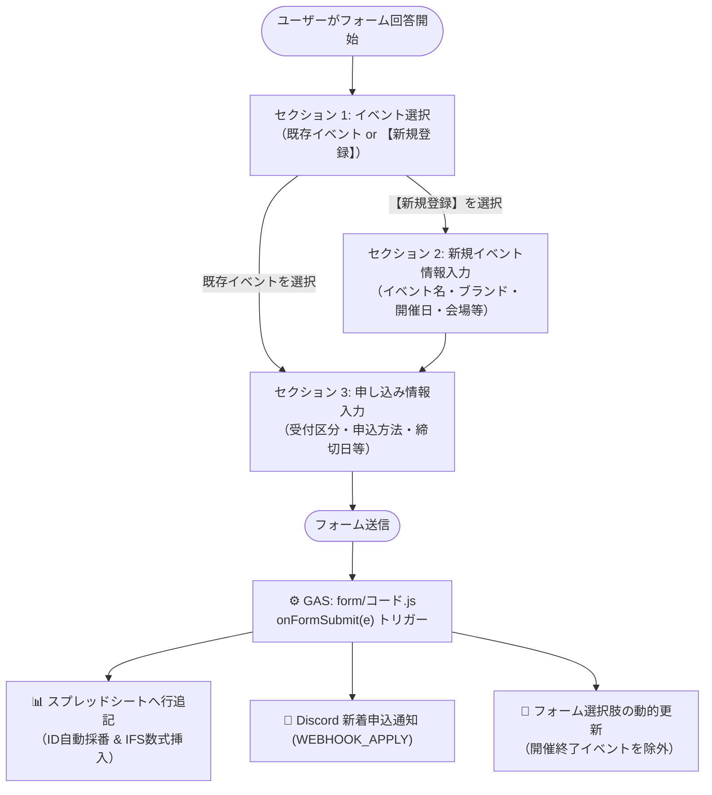

# Google フォーム連携仕様書 (`docs/FORM_SPEC.md`)

本ドキュメントは `discord-notifier` システムにおける Google フォーム連携、設問項目、選択肢動的同期、およびフォーム送信時トリガー処理に関する仕様書です。

> 📖 **設計原則・全体レイヤー構造**: [docs/ARCHITECTURE.md](ARCHITECTURE.md)  
> 📖 **データエンティティ・システム仕様**: [docs/SYSTEM_SPEC.md](SYSTEM_SPEC.md)

---

## 1. フォーム連携フロー概要

Webアプリからの登録機能と並存して、Google フォーム経由での新規イベント・申込登録をサポートしています。

---

## 2. セクション構成と設問項目仕様

### ■ セクション 1: イベント選択

| 設問タイトル | フォーム要素 | 必須 | 概要・動的同期の仕様 |
| :--- | :--- | :--- | :--- |
| **イベント名** | ドロップダウン / リスト | 必須 | スプレッドシートの「イベントマスター」シートから自動同期された選択肢。 ・既存イベント選択時 ➔ **セクション 3 へ移動** ・`【新規登録】新しいイベントを入力する` 選択時 ➔ **セクション 2 へ移動** |

### ■ セクション 2: 新規イベント情報入力

> ※「イベント名」で `【新規登録】新しいイベントを入力する` を選択した場合のみ遷移

| 設問項目名 | フォーム要素 | 必須 | 格納先プロパティ / データ形式 |
| :--- | :--- | :--- | :--- |
| **新規イベント名（新しいイベントの場合のみ入力）** | 記述式 (短文) | 必須 | `eventName` (文字列) |
| **ブランド** | 記述式 / リスト | 任意 | `brand` (例: `学マス`, `デレ`, `シャニ`) |
| **開始日** | 日付 | 必須 | `startDate` (`yyyy-MM-dd`) |
| **終了日** | 日付 | 任意 | `endDate` (`yyyy-MM-dd` / 省略時は開始日と同日) |
| **会場** | 記述式 (短文) | 任意 | `location` (開催場所) |
| **イベント概要** | 段落 (長文) | 任意 | `summary` (メモ・補足情報) |

### ■ セクション 3: 申し込み情報入力 (共通)

> 既存イベント選択、または新規イベント入力完了後に共通で入力するセクション

| 設問項目名 | フォーム要素 | 必須 | 格納先プロパティ / データ形式 |
| :--- | :--- | :--- | :--- |
| **受付名（先行/一般など）** | 記述式 (短文) | 必須 | `applyName` (例: `一般先行`, `一般先着`, `公式リセール`) |
| **申込方法** | 記述式 / 段落 | 任意 | `method` (チケット販売URL、応募手順テキスト等) |
| **申込開始日** | 日時 | 任意 | `startDatetime` (`yyyy-MM-dd HH:mm`) |
| **申込締切日** | 日時 | 必須 | `endDatetime` (`yyyy-MM-dd HH:mm`) |
| **当落発表日** | 日時 | 任意 | `resultDatetime` (`yyyy-MM-dd HH:mm`) |
| **入金締め切り日** | 日時 | 任意 | `payEndDatetime` (`yyyy-MM-dd HH:mm`) |

---

## 3. フォーム送信時トリガー処理 (`form/コード.js`)

フォーム側スクリプトでは、以下の自動処理がイベントトリガーによって実行されます。

### 3.1 `onFormSubmit(e)` (フォーム送信時トリガー)
1. **データ解析**: フォームの回答（`FormResponse`）から各セクションの入力値を抽出。
2. **イベントマスター更新**: 新規イベントが入力された場合、新しい `EV-xxx` を採番して「イベントマスター」シートへ追記。
3. **申し込み管理追記**: `AP-xxx` を採番し、「申し込み管理」シートへ追記。ステータス自動計算用の `IFS` 数式を付与。
4. **フォーム選択肢の動的更新**: `updateFormOptions()` を呼び出し、最新の有効イベント一覧を選択肢ドロップダウンに反映。
5. **Discord 即時通知**: `WEBHOOK_APPLY` に対して、新着申込の登録通知を送信（フッターなし）。

### 3.2 選択肢動的更新の仕組み (`updateFormOptions`)
- スプレッドシートの「イベントマスター」シートからイベント一覧を取得。
- **終了日が本日以降（開催中または開催前）のイベントのみ** を抽出し、先頭に `【新規登録】新しいイベントを入力する` を付加したリストでフォーム設問の選択肢を上書き更新します。
- これにより、すでに終了した過去のイベントがフォームのドロップダウンに残り続けることを防ぎます。
