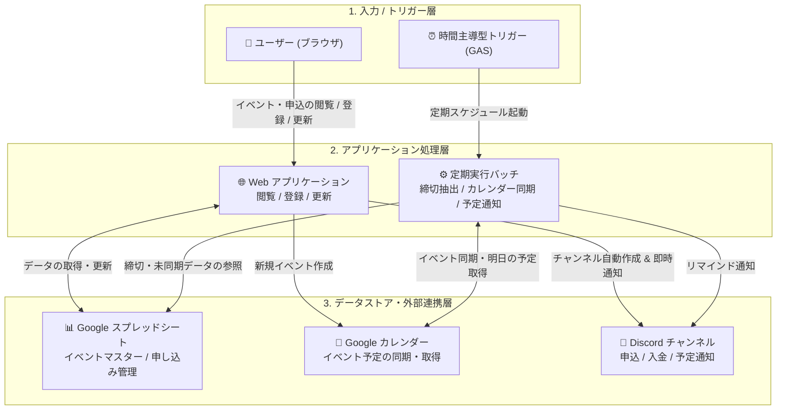

# システム構造 & データ仕様書 (`docs/SYSTEM_SPEC.md`)

本ドキュメントは `discord-notifier` システムにおけるデータエンティティ定義、定期通知バッチ仕様、Webアプリ API 仕様、Discord 通知仕様および自動化トリガーに関する仕様書です。

> 📖 **設計原則・レイヤー構造**: [docs/ARCHITECTURE.md](ARCHITECTURE.md)  
> 💡 **旧 Google フォーム連携**: 廃止済み（過去仕様・コードは [Release: legacy-form-final](https://github.com/miyagey/discord-notifier/releases/tag/legacy-form-final) を参照）

---

## 1. システム全体データフロー

本システムは **Webアプリ** からのイベント・申込登録と、**定期通知バッチ** による Discord リマインド通知を主軸としています。



---

## 2. データエンティティ定義（スプレッドシート）

スプレッドシートはデータストアとして機能し、データアクセス層（`SheetService`）が列構造を隠蔽して外部層にエンティティオブジェクト（DTO）を提供します。

### 2.1 イベントエンティティ (`EventMaster`)
「イベントマスター」シートで管理されるイベント基本情報です。

| 項目名 (プロパティ) | 表示列名 | データ型 | 説明・仕様 |
| :--- | :--- | :--- | :--- |
| `id` | イベントID | 文字列 | `EV-001`, `EV-002` ... 形式で自動採番 |
| `brand` | ブランド名 | 文字列 | ブランド表記 (例: `学マス`, `デレ`, `シャニ`) |
| `name` | イベント名 | 文字列 | イベントの正式名称 |
| `startDate` | 開始日 | 日付 | 開催開始日 (`yyyy-MM-dd`) |
| `endDate` | 終了日 | 日付 | 開催終了日 (`yyyy-MM-dd`)。単日の場合は開始日と同日 |
| `location` | 会場 | 文字列 | 開催場所・会場名 |
| `summary` | イベント概要 | 文字列 | 補足説明・メモ |
| `calId` | カレンダー登録ID | 文字列 | Google カレンダー同期時の Event ID |
| `status` | ステータス | 文字列 | 自動計算ステータス (`開催前` / `開催期間` / `開催終了`) |
| `discordChannelId` | Discord チャンネルID | 文字列 | Discord Bot API で自動作成されたイベント専用チャンネルID |

#### ステータス自動計算ルール (数式)
```excel
=IFS(
  ISBLANK(D2), "未設定",
  TODAY() < INT(D2), "開催前",
  TODAY() <= INT(IF(ISBLANK(E2), D2, E2)), "開催期間",
  TRUE, "開催終了"
)
```

---

### 2.2 申し込みエンティティ (`Application`)
「申し込み管理」シートで管理されるチケット申し込み・抽選・入金スケジュールです。

| 項目名 (プロパティ) | 表示列名 | データ型 | 説明・仕様 |
| :--- | :--- | :--- | :--- |
| `id` | 申し込みID | 文字列 | `AP-001`, `AP-002` ... 形式で自動採番 |
| `eventId` | イベントID | 文字列 | 紐付く「イベントマスター」の `id` (`EV-xxx`) |
| `brand` | ブランド名 | 文字列 | 表示用ブランド名（親イベントと同期） |
| `eventName` | イベント名 | 文字列 | 表示用イベント名（親イベントと同期） |
| `applyName` | 受付名/区分 | 文字列 | 受付区分 (例: `アソビストア限定先行`, `一般先着`, `公式リセール`) |
| `startDatetime` | 申込開始日時 | 日時 | `yyyy-MM-dd HH:mm` |
| `endDatetime` | 申込締切日時 | 日時 | `yyyy-MM-dd HH:mm` |
| `method` | 申込方法 | 文字列 | チケット申込URLまたは応募手順などのテキスト |
| `resultDatetime` | 当落発表日時 | 日時 | `yyyy-MM-dd HH:mm` |
| `payEndDatetime` | 入金締切日時 | 日時 | `yyyy-MM-dd HH:mm` |
| `status` | ステータス | 文字列 | 自動計算ステータス (下記参照) |
| `parentEvent` | 親イベント情報 | オブジェクト | 紐付くイベントの日程・会場等のオブジェクト |

#### ステータス自動計算ルール (数式)
```excel
=IFS(
  AND(NOT(ISBLANK(F2)), NOW() < F2), "開始前",
  AND(NOT(ISBLANK(G2)), NOW() <= G2), "受付期間",
  AND(NOT(ISBLANK(I2)), NOW() < I2), "抽選終了・当落確認前",
  AND(NOT(ISBLANK(J2)), NOW() <= J2), "当落確認・入金期間",
  TRUE, "期間終了"
)
```

> [!NOTE]
> スプレッドシート上の列インデックス（0始まり）はすべて `spreadsheet/スプレッドシート操作.js` 内の定数（`MASTER_COL`, `APPLY_COL`）としてカプセル化されており、プログラムが列位置に直接依存することはありません。

---

## 3. Webアプリ仕様 (`spreadsheet/Webアプリ.js`)

Google Apps Script の Webアプリ機能（HTML Service）を用いた Single Page Application (SPA) です。

### 3.1 構成とアクセス
- **エントリーポイント**: `doGet(e)`
- **フロントエンド**: `spreadsheet/index.html`（Glassmorphism UI / モバイルファースト）
- **公開URL**: `WEBAPP_URL`（Cloudflare 経由の短縮ドメイン等）

### 3.2 サーバー側 API インターフェース

| 関数名 | 引数 | 戻り値 | 処理内容 |
| :--- | :--- | :--- | :--- |
| `doGet(e)` | `e` (イベント) | `HtmlOutput` | Webアプリ画面を返却。初期データ（`events`, `applications`, `brands`）をHTMLに直接注入して高速表示 |
| `getAppData()` | なし | `{ events, applications, brands }` | 最新のイベント・申込一覧を取得 |
| `createEvent(data)` | `{ brand, name, startDate, endDate, location, summary }` | `{ success, eventId, discordChannelId }` | イベント新規登録。Googleカレンダー追加、Discordテキストチャンネル自動作成（トピック設定・初回Embed投稿・ID書き戻し）、および通知を実行 |
| `updateEvent(data)` | `{ id, brand, name, startDate, endDate, location, summary }` | `{ success }` | イベント情報更新。申し込み管理シートのブランド名・イベント名も同期更新 |
| `createApplication(data)` | `{ eventId, brand, eventName, applyName, startDatetime, endDatetime, resultDatetime, payEndDatetime, method }` | `{ success, applyId }` | 申込新規登録。Discord 通知（`WEBHOOK_APPLY`）を実行 |
| `updateApplication(data)` | `{ id, eventId, applyName, startDatetime, endDatetime, resultDatetime, payEndDatetime, method }` | `{ success }` | 申込情報更新（数式列は維持） |

### 3.3 フロントエンド表示・アーカイブ仕様 (`spreadsheet/index.html`)

- **ファーストビューとアーカイブの分離**:
  - イベント終了（または申込締切）から 90 日以上経過した過去データは、ファーストビュー（通常タブ）の一覧から自動除外して一覧性を維持。
  - 「📦 アーカイブ」タブを選択することで、開催年（YYYY）ごとにグループ化されたアコーディオン形式で過去イベント・申込を閲覧可能（最新年は初期展開）。
- **カードの視認性向上と URL 短縮**:
  - 長大な URL（トラッキングパラメータ付き等）は 35 文字程度に短縮し、「`https://...`」の外部リンクタグとして表示。
  - 概要（`description`）は 3 行までの省略表示とし、クリックで全文展開可能。カードの枠突き破りやレイアウト崩れを防止。
- **新規登録フォームの選択肢最適化**:
  - チケット新規登録モーダル（`openTicketFormModal`）では、アーカイブ済みおよび終了済みのイベントを候補から除外し、選択肢の肥大化を防止。

---

## 4. 定期通知バッチ仕様 (`spreadsheet/定期通知バッチ.js`)

時間主導型トリガーによって定期実行されるバッチ処理群です。

### 4.1 バッチジョブ一覧
メイン関数（オーケストレーション層）は一本道のフロー制御のみを行い、対象件数の判定や0件時のログ出力・送信スキップ処理はすべて各サービス層（`DiscordService`, `CalendarService`）内部で実行されます。

| 関数名 | 実行タイミング (推奨) | 抽出条件 | 通知先 Webhook | 対象なし時の挙動（サービス層内部判定） |
| :--- | :--- | :--- | :--- | :--- |
| `remindEndDate` | 毎日 午前 (例: 08:00〜09:00) | ① 本日締切の通常申込（先着・リセール除く、締切時刻考慮）<br>② 翌日開始の先着受付<br>③ 現在受付期間中のリセール | `WEBHOOK_APPLY` | 通常申込なし時は「本日締切のチケット申込はありません」と案内通知。<br>先着・リセールは対象なし時は通知をスキップ |
| `remindPaymentEndDate` | 毎日 午前 (例: 08:00〜09:00) | 本日入金締切のチケット（締切時刻考慮） | `WEBHOOK_PAYMENT` | **対象なし時は通知を送信せず、ログ出力のみで終了** |
| `registerEventsToCalendar` | 定期実行 (1時間毎推奨) | カレンダー未登録（`calId` が空）かつ開始日が入っているイベント | `WEBHOOK_CALENDAR` | 対象なし時はログ出力のみで終了。<br>登録成功時はカレンダーIDを更新し一括で Discord 通知 |
| `notifyTomorrowEvents` | 毎日 夕方〜夜 (例: 20:00〜21:00) | Google カレンダーの翌日終日・時間指定イベント | `WEBHOOK_CALENDAR` | 予定なし時は「明日の予定はありません」と通知 |

---

## 5. Discord 通知仕様

### 5.1 チャンネル別の通知送信・フッター要件

| チャンネル / Webhook | 送信トリガー | フッター有無 | 備考 |
| :--- | :--- | :--- | :--- |
| `WEBHOOK_APPLY` | 申込締切リマインド（通常） | **あり** (WebアプリURL案内) | 対象0件時も案内通知 |
| `WEBHOOK_APPLY` | 翌日先着リマインド / リセールリマインド | **なし** | 該当がある場合のみ送信 |
| `WEBHOOK_APPLY` | Webアプリからの新規申込登録 | **なし** | 即時通知 |
| `WEBHOOK_PAYMENT` | 本日入金締切リマインド | **なし** | **対象0件時は送信せずスキップ** |
| `WEBHOOK_CALENDAR` | Google カレンダー同期完了通知 | **なし** | バッチ / Webアプリ共通 |
| `WEBHOOK_CALENDAR` | 明日の予定一覧通知 | **なし** | 予定サマリー |

### 5.2 通知メッセージサンプル

#### 申込締切リマインド (フッターあり)
```
🔔 **本日締切のチケット申込があります！**

📅 **【デレ】THE IDOLM@STER CINDERELLA GIRLS...**
 └ 受付区分: 一般先行
 └ 締切時刻: **23:59まで**
 └ 申込方法: https://eplus.jp/...

----------------------------------------
📝 **イベント・申込の確認＆登録はこちら**
・【Webアプリ (一覧・登録)】: https://your-webapp-url
```

#### 入金締切リマインド (フッターなし・対象がある場合のみ送信)
```
💸 **本日入金締切のチケットがあります！**

📅 **【学マス】学園アイドルマスター DEBUT LIVE...**
 └ 受付区分: アソビストア限定先行
 └ 入金締切: **21:00まで**
 └ 申込方法: https://asobistore.jp/...
```
